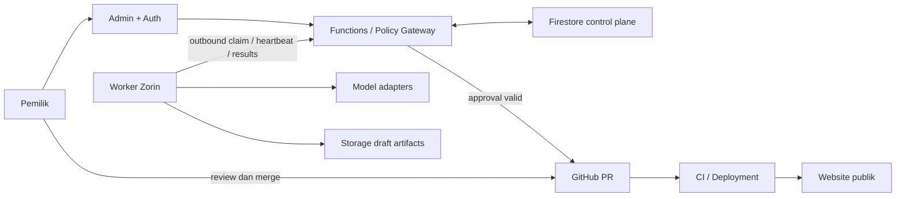

# Arsitektur

Status: target arsitektur agent; aplikasi root kini memiliki homepage personal V4 statis. Backend dan integrasi tetap rancangan. Lihat [project-status.md](project-status.md).

## Pembagian tanggung jawab

| Komponen | Peran target | Lokasi |
| --- | --- | --- |
| Website | Konten publik dan halaman personal | Cloud hosting Next.js, vendor belum dipilih |
| Admin | Login, instruksi, preview, approval, pemantauan | Cloud, aplikasi terpisah |
| Auth + Functions v2 | Identitas, otorisasi, mutasi sensitif, OAuth, broker publikasi | Firebase/Google Cloud |
| Firestore | Task, state, approval, metadata, jadwal dan audit | Cloud control plane |
| Storage | Draft panjang, gambar/media, artefak versi tertentu | Firebase Storage |
| Worker | Orchestrator, tool runner, model router | PC Zorin OS, Node.js/TypeScript, Docker Compose direncanakan |
| GitHub + CI | Kode, MDX terbit, PR/checks, provenance deployment | GitHub dan platform hosting |
| Provider AI | Local LLM untuk tugas ringan; cloud/image sesuai policy | Lokal/API melalui adapter |



Worker tidak membuka inbound port. Polling adaptif mengambil pekerjaan melalui gateway backend yang memvalidasi identitas dan lease; Firebase SDK administratif penuh tidak diberikan ke sandbox agent. Pendekatan ini memperjelas batas write sensitif meskipun Firestore tetap antrean bisnis. Scheduler cloud membuat task dengan deduplication key; PC offline berarti task tetap menunggu.

## Source of truth

- **GitHub** menyimpan kode, artikel MDX yang disetujui/terbit, serta manifest referensi media immutable. SHA commit dan hasil deployment mengidentifikasi versi yang benar-benar live.
- **Firestore** menyimpan status workflow, approval, metadata draft, publication ledger, dan referensi commit; bukan sumber body artikel live kedua.
- **Storage** menyimpan draft MDX/media versi immutable. Media final boleh tetap berada di storage, tetapi hash dan referensi versinya dicatat pada manifest di GitHub. Jangan overwrite media yang sudah disetujui.
- **Knowledge base** awal berupa Markdown dan retrieval sederhana. Fakta pribadi terverifikasi dipisahkan dari riset eksternal. Vector database belum diperlukan.
- Checkpoint orchestrator membantu resume, namun tidak menggantikan audit log atau status bisnis Firestore.

Untuk sosial, provider menyimpan posting aktual; GitHub menyimpan sumber konten, dan Firestore ledger mencatat versi payload serta remote post ID. Status `published` hanya ditetapkan setelah konfirmasi provider atau rekonsiliasi.

## Struktur sekarang

```text
kiswanto-id/
├── app/                 # homepage personal responsif
├── public/              # logo, portrait, teknologi SVG lokal
├── docs/                # rancangan dan status
├── AGENTS.md
├── README.md
├── package.json
└── package-lock.json
```

## Target monorepo fase 1B — belum dibuat

```text
kiswanto-id/
├── apps/
│   ├── website/         # migrasi aplikasi root
│   ├── admin/           # Next.js admin, PWA bertahap
│   └── worker/          # runtime Node.js di Zorin
├── functions/           # Firebase Functions v2 / policy gateway
├── packages/
│   ├── contracts/      # Zod + tipe bersama
│   ├── agent-core/     # state machine, router, tool registry
│   └── ui/             # komponen bersama hanya bila diperlukan
├── content/             # MDX terbit + manifest media
├── knowledge/           # sumber fakta/brand terverifikasi
├── infra/               # rules, indexes, worker deployment
├── docs/
├── pnpm-workspace.yaml
└── turbo.json
```

Migrasi diusulkan memakai pnpm workspaces + Turborepo. Saat migrasi, pindahkan app ke `apps/website`, ubah scripts/CI, dan ganti lockfile secara konsisten; jangan memelihara npm dan pnpm lockfile sekaligus. Setiap aplikasi mempunyai environment dan identity tersendiri. Direktori rencana tidak dibuat kosong pada fase ini.

## Pilihan runtime yang direncanakan

LangGraph.js untuk orkestrasi/checkpoint, Zod untuk contract validation, shadcn/ui untuk admin, Vitest/Playwright untuk test, Pino/OpenTelemetry untuk observability. Semua masih usulan dan belum terpasang. Model router mencatat provider/model/version, latency, penggunaan, biaya estimasi/aktual, dan alasan fallback.

Queue menggunakan lease, fencing token dan idempotency. Backend berwenang memvalidasi approval; publisher berizin sempit mengeksekusi side effect. Detail di [agent-workflow.md](agent-workflow.md) dan [security.md](security.md).

## Deployment dan kegagalan

Hosting website/admin belum dipilih. GitHub Actions menjadi rencana pipeline; tidak ada workflow aktif. Build preview dan production dipisah, identity deployment tidak dibagikan ke coding sandbox. Worker mati tidak menghentikan website/admin. Cloud publisher kecil hanya opsi fase 8 untuk jadwal ketat yang harus tetap berjalan saat PC mati.

Firebase project ID belum dipilih. Proyek Warza yang sudah ada berbagi `beekasir-60f31`/`beekasir`; rencana root collections di dokumen schema mengasumsikan namespace Kiswanto AI terisolasi. Jika memakai project bersama, tentukan namespace dan rules terlebih dahulu untuk mencegah tabrakan data.
